# Lohgo

Lohgo is a Logo programming studio that runs entirely in your browser. You type
`forward 100`, the turtle walks, and a line appears. You teach it new words with `to`
and `end`, and those words become part of the language. From there you can go as far as
Logo goes: recursion, lists, words, templates, files, events, several turtles at once,
even macros. Then you can stop the program in the middle of a recursive tree, see every
copy of the procedure that is waiting on the call stack, change a value, and carry on.

Logo was my first language, before BASIC. I wanted something I could hand to a child in
a classroom, to a student meeting recursion for the first time, or to someone who
remembers the turtle from an Apple II, without asking anyone to install anything. Lohgo
is a single HTML file. There is no server, no account, and no network access. Open it and
start typing.

Live at https://lohgo.jyotiprakash.org

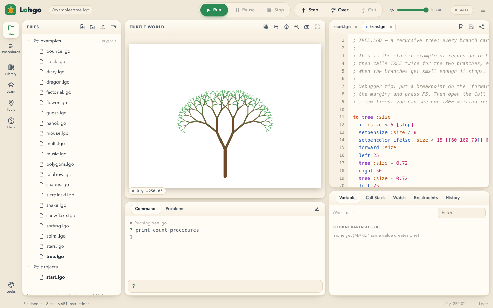

## What you can do with it

Type commands in the command center and the turtle does them at once. Write longer
programs in the editor and press F5 to run them. The procedures a program defines stay
defined afterwards, so you can keep calling them from the command center, which is how
Logo has always been used.

When you want to see what a program is doing, set a breakpoint, run, and step through it
one instruction at a time. The debugger understands Logo's dynamic scope and recursion:
every active procedure is listed with its own inputs and local variables, and you can
select any one of them and change its values while the program waits.

If you are new to programming there is a course of lessons that starts with the very
first `forward` and ends with you building a game, a set of guided tours of the studio,
and a reference for every primitive with an example you can run with one click. If you
already know Logo, there is a library of programs to read, run and take apart.

## The command center

The command center is the classic Logo listener. Type an instruction and press Enter.
Values that an instruction outputs are shown, errors are explained in plain words, and
`to` at the prompt lets you define a procedure line by line, ending with `end`. The arrow
keys bring back earlier commands and Tab completes the name of a primitive or one of your
own procedures. When a program asks a question with `readlist` or `readword`, the same
line is where you answer it.

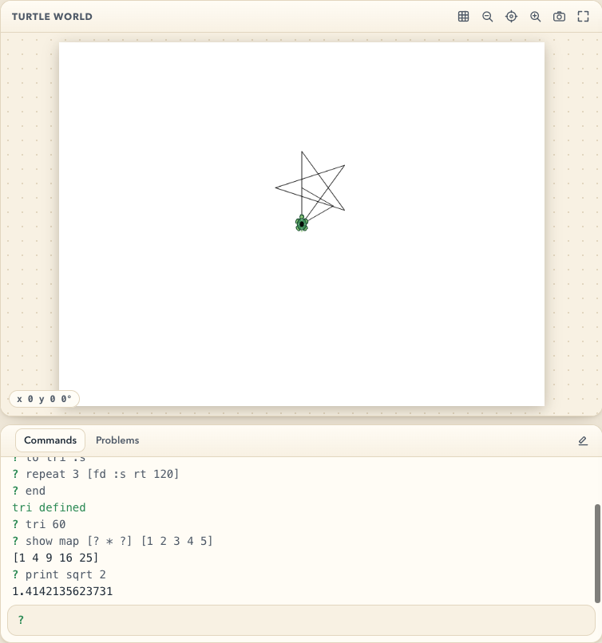

## The language

Lohgo follows Berkeley Logo (UCBLogo), the most complete and best documented Logo, so the
books written for it work here. That covers:

- words, numbers and lists, with `first`, `butfirst`, `word`, `sentence`, `fput`, `lput`,
  `item`, `member` and the rest, and arrays with any origin, written `{1 2 3}@0`;
- procedures with required, optional and rest inputs (`to greet :name [:greeting "Hello]`),
  `output` and `stop`, and Logo's dynamic scope with `local` and `localmake`;
- infix arithmetic with Berkeley's precedence, so `sum 3 4 * 2` is 11, and the unary
  minus spacing rule, so `fd -:x` and `3 - 2` both mean what they look like;
- every control structure: `repeat` with `repcount`, `forever`, `for`, `while`, `until`,
  `do.while`, `do.until`, `if`, `ifelse` (both usable as operations), `test` with `iftrue`
  and `iffalse`, `case`, `cond`, `goto` and `tag`, `catch`, `throw` and `error`;
- templates: `map`, `filter`, `find`, `reduce`, `foreach`, `apply`, `invoke`, `crossmap`,
  `cascade` and `transfer`, with `?`, `?1`, `?rest` and `#` slots or named slots like
  `[[x] :x * 2]`;
- `run` and `runresult`, `define` and `text`, property lists, stacks and queues with
  `push`, `pop`, `queue` and `dequeue`, `.macro` and backquote;
- the workspace commands: `po`, `pots`, `erase`, `bury`, `trace`, `step`, `save`, `load`
  and friends;
- files on a disk that lives in your browser: `openread`, `openwrite`, `openappend`,
  `setread`, `setwrite`, `readlist`, `readword`, `readchar`, `eofp`, `dribble`, and
  Berkeley's string streams, where opening `[name]` reads from or writes into a variable.

Error messages use Berkeley Logo's wording ("fd doesn't like abc as input", "I don't know
how to foo"), so they match what the books say, and `catch "error` with `error` reports
them the same way, with a code, the message, the procedure and the line.

On top of Berkeley Logo, Lohgo has the turtle, colour and event commands that MSWLogo and
FMSLogo made popular on Windows: `setpencolor` with `[r g b]` lists, `setfloodcolor`,
`ellipse`, `mouseon`, `keyboardon`, `settimer`, `sound` and `tone`, folders with `chdir`,
`files` and `mkdir`. From LCSI Logo it borrows `tell`, `ask`, `each` and `who` for
working with several turtles at once, and turtle shapes with `setshape` and `stamp`.

Altogether there are 375 primitives, and each one has a page in the reference.

## Turtle graphics

The turtle world is 800 by 600 turtle steps with the origin in the middle and the y axis
pointing up, the same coordinates the old Logo books use. It is drawn at twice that
resolution so lines stay smooth, and it scales to whatever space it has, from a phone to
a large monitor. You can zoom in, put graph paper behind the drawing to read coordinates
off it, and save the picture as a PNG.

Colours can be the sixteen standard Logo colours by number, any colour by name, an
`[r g b]` list or a `#rrggbb` word. Pens can paint, erase or reverse. `fill` floods an
area, `filled` fills the shape the turtle walks around, `arc` and `ellipse` draw curves,
and `label` writes text. The turtle can wrap around the edges, fence itself in, or wander
off the visible world. A speed slider runs from instant down to one instruction at a time,
so you can watch the turtle walk and see each line light up in the editor as it runs.

<p>
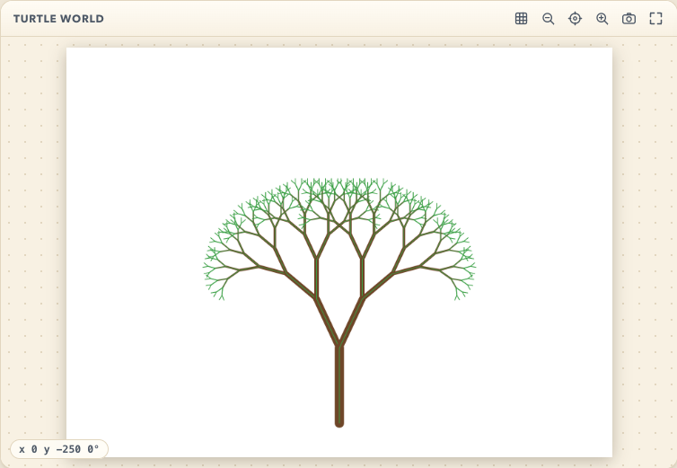
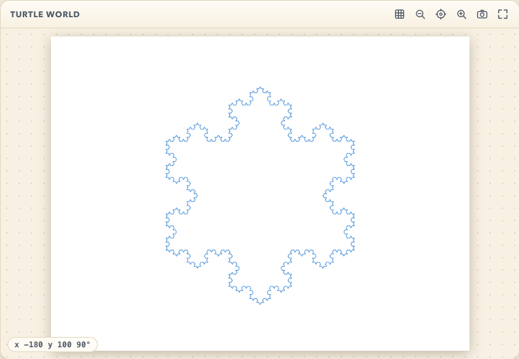
</p>
<p>
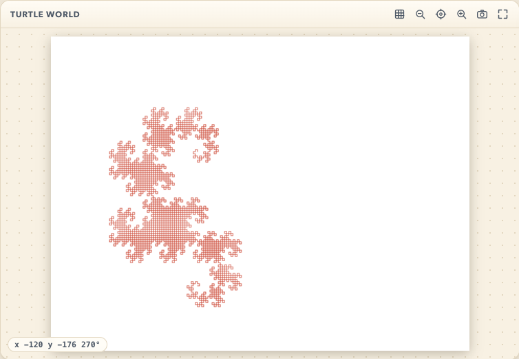
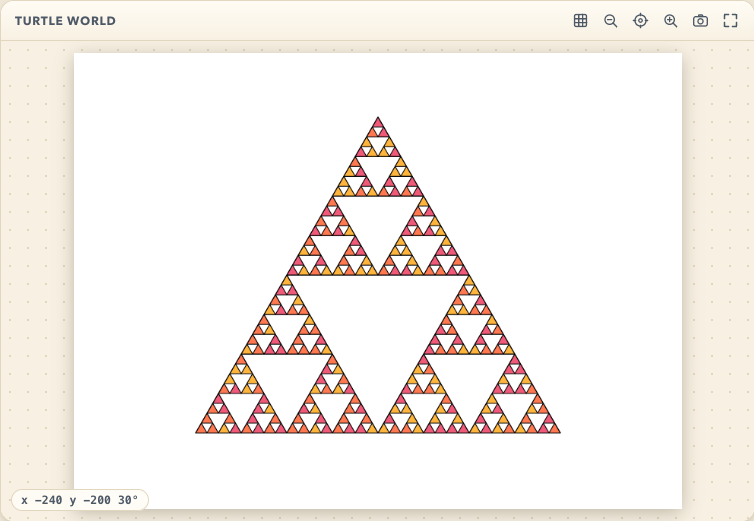
</p>
<p>
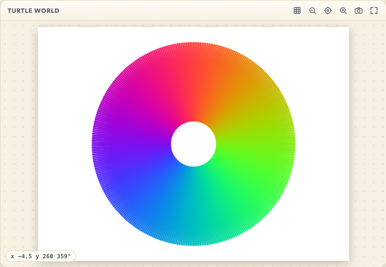
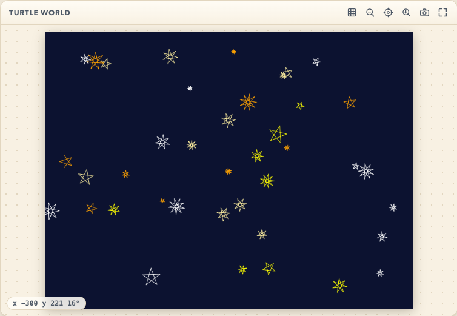
</p>
<p>
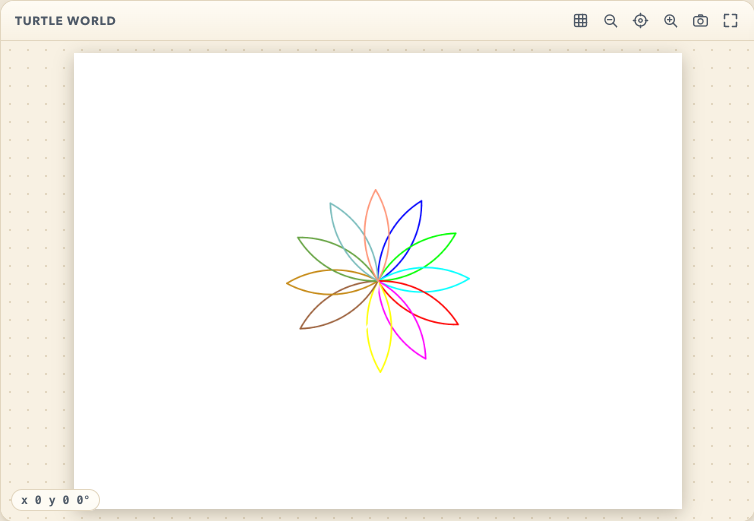
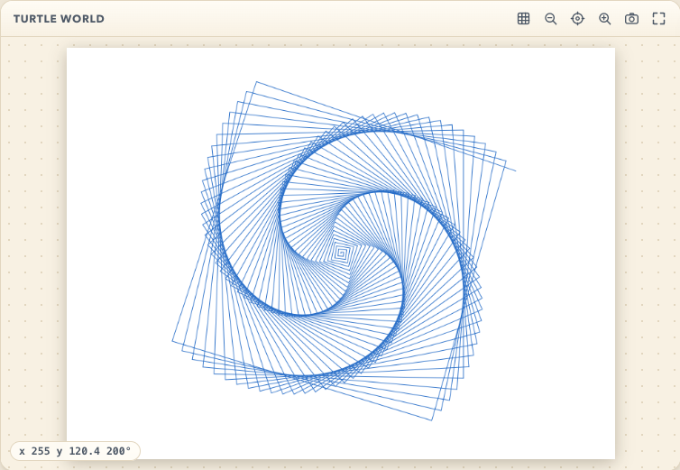
</p>

## The debugger

This is the part I care about most, because recursion is where people get stuck and Logo
is where many people first meet it. Click in the margin next to a line to set a
breakpoint. Right-click it to stop only when a condition is true, such as `:n = 3`. Then
press F5. Step (F11) runs one instruction and goes into the procedures it calls, Over
(F10) runs a whole line, and Out finishes the current procedure.

While the program is paused, the Call Stack shows every procedure that is waiting for
another one to finish, newest first, each with its inputs. Here a recursive factorial has
stopped four levels deep:

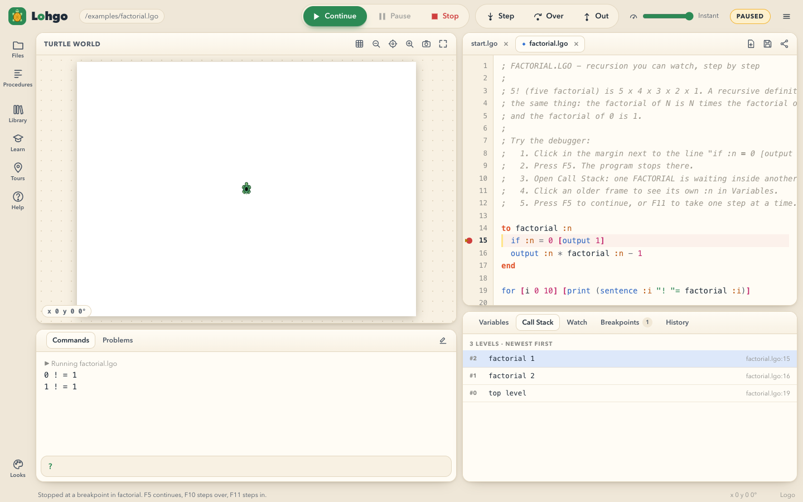

Selecting an older frame shows its own `:n` in the Variables panel, and the line where it
is waiting is marked in the editor. Clicking a value lets you type a new one: a number, a
`"word`, a `[list]` or an `{array}`. Lists and arrays fold open one level at a time, and
property lists are shown too. Because Logo variables are dynamically scoped, the panel
shows exactly the variables a frame can see, including the loop variable of a `for` that
is running inside it.

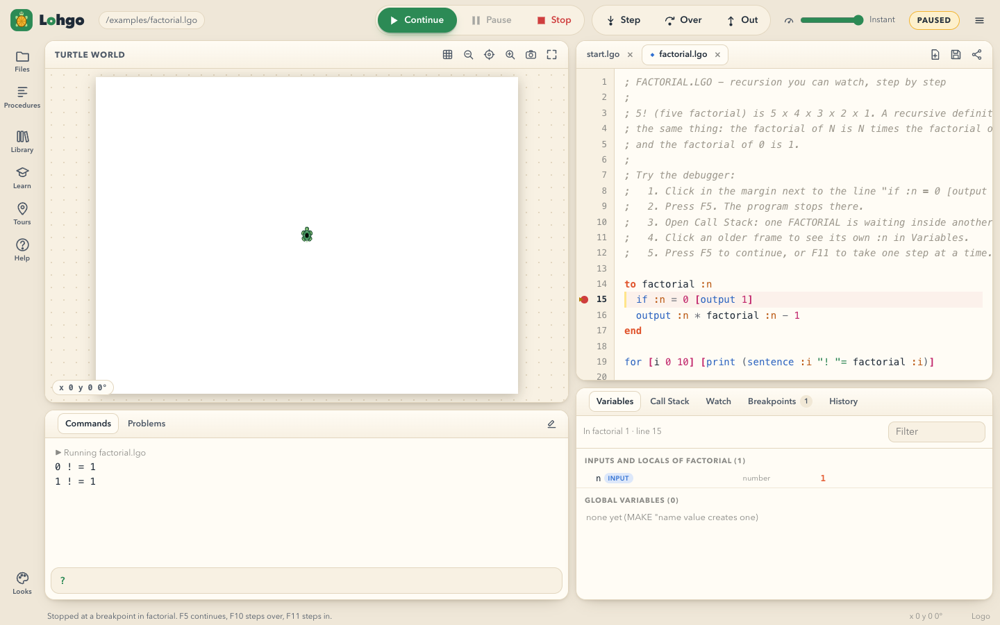

Pointing at a variable in the editor while the program is paused shows its value in a
small callout. It stays open when you move into it, so you can unfold a list and change a
value right there.

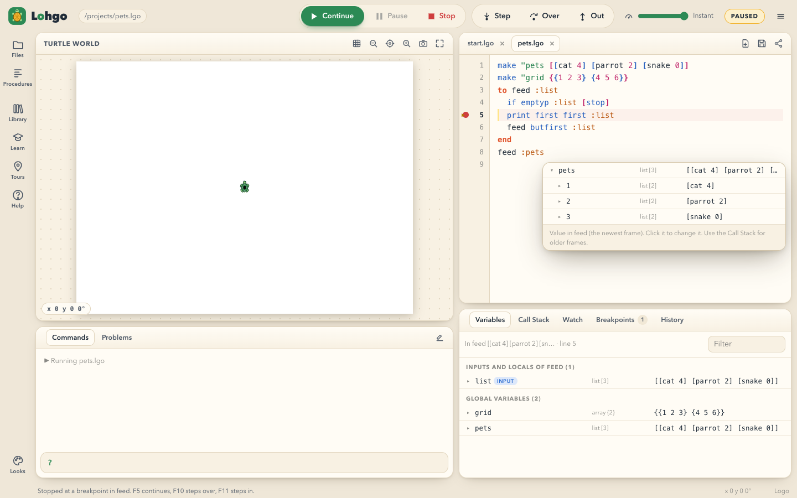

The Watch panel evaluates expressions every time the program stops, and a watch can stop
the program by itself when its value changes or becomes true. The History panel lists the
last instructions that ran. Typing in the command center while paused runs the
instructions inside the selected frame, so `print :size * 2` sees that frame's `:size`.
When a program fails, it keeps its frames, so you can still look at every level and type
commands against them to find out what went wrong.

Berkeley's own debugging commands work as well: `trace` prints every call and result,
`step` makes the debugger stop at every instruction of a procedure, and `pause` stops the
program where it is.

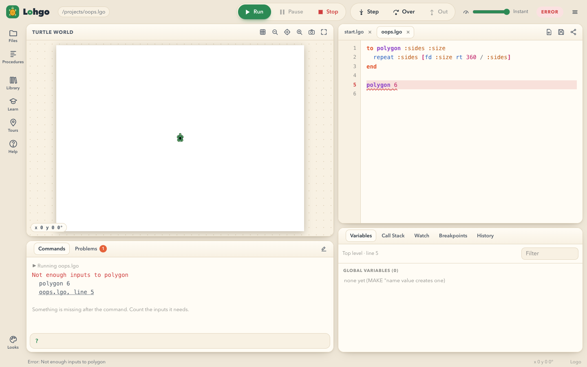

## The program library

The library has 504 programs in twenty-one categories: shapes and polygons,
patterns and mandalas, spirals and curves, fractals, generative art, animation and many
turtles, games, puzzles, mathematics, geometry, number theory, words and text, lists and
data structures, algorithms, recursion, science and simulation, music and sound, files,
school helpers and quizzes, stories and chatbots, and classic Logo programs in the style of
the early Logo books.

Every program starts with a header that says what it does, how to use it, which ideas it
teaches and some things to try changing, and the code underneath is commented so you can
learn from reading it. The recursion programs say where to put a breakpoint and what to
look for in the call stack. The library is compressed into the page and unpacked only when
you first open it.

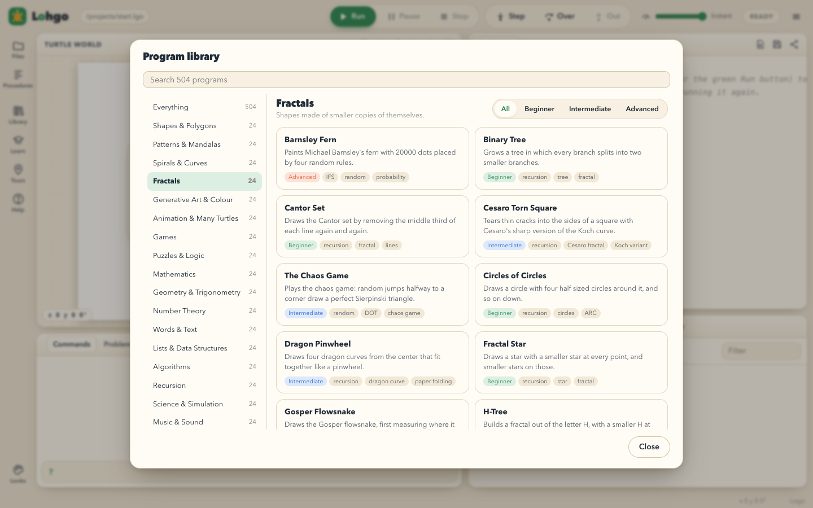

## Learning Logo

The Learn button opens a course of 68 lessons in sixteen units. It starts with moving the
turtle and works through repeat, procedures and inputs, colours and coordinates, numbers,
variables and scope, decisions, words, lists, recursion, loops and templates, input and
the keyboard and mouse, arrays, property lists and files, and then `run`, `catch`,
`define`, macros and several turtles, before a final unit where you build a game.

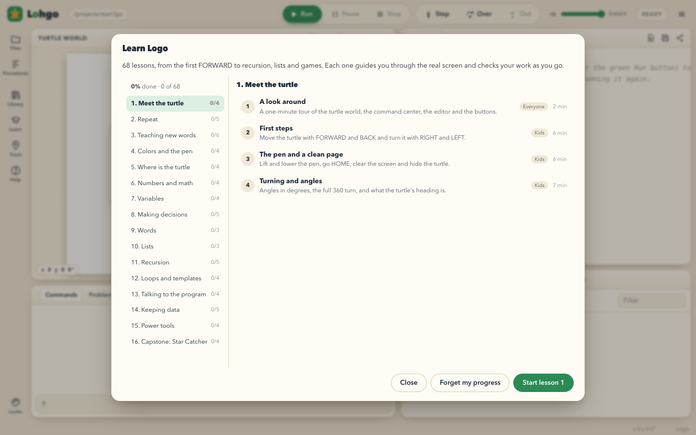

Each lesson walks you through the real studio. It points at what to look at, gives you
something to type or change, and waits until you have done it before going on. There is a
hint when you get stuck and a short quiz at the end. Progress is kept in your browser.

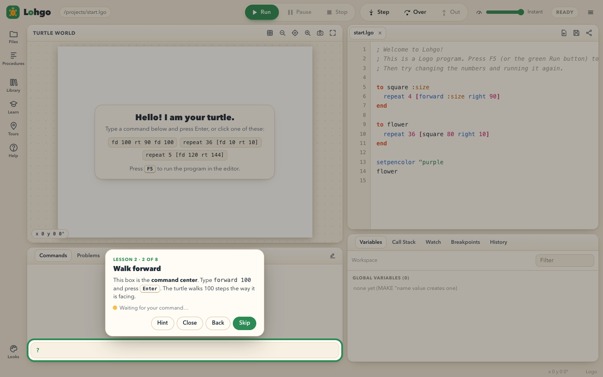

There are also guided tours of the studio itself: a welcome tour the first time you open
it, and tours for your first program, turtle graphics, the debugger, and files and
sharing.

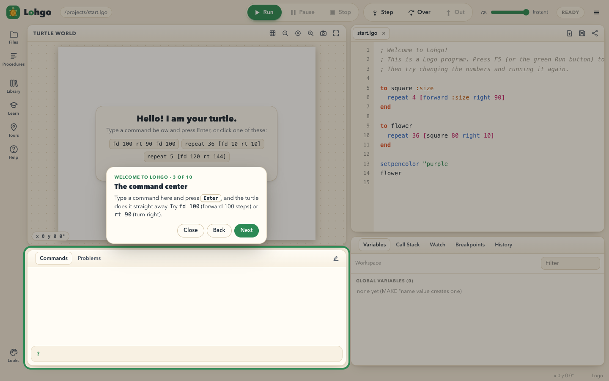

F1 opens the reference at the word under the cursor. Every primitive has its inputs, a
plain explanation, the error you get when you use it wrongly, related primitives and an
example that runs with one click. There are topic pages too, on quoting and colons,
infix precedence, dynamic scope, recursion, templates, the debugger and the common error
messages.

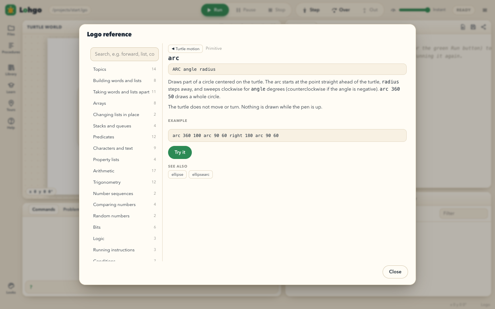

## Files and sharing

Programs live on a small disk kept in your browser. Your own programs go in `/projects`.
The examples, the library and the lessons are kept as originals: you can change and run
them, but saving one asks for a name and keeps your copy in `/projects`, so the original is
always there. Programs can read and write files on the same disk, and in Chrome and Edge
you can also use a real folder from your computer, choosing whether programs may only read
it, must ask before each change, or may write freely.

Any program or folder can be shared as a link. The files are compressed into the part of
the link after the `#`, which browsers never send anywhere, so nothing is uploaded and
whoever opens the link gets their own copy. Folders can also be downloaded as a zip.

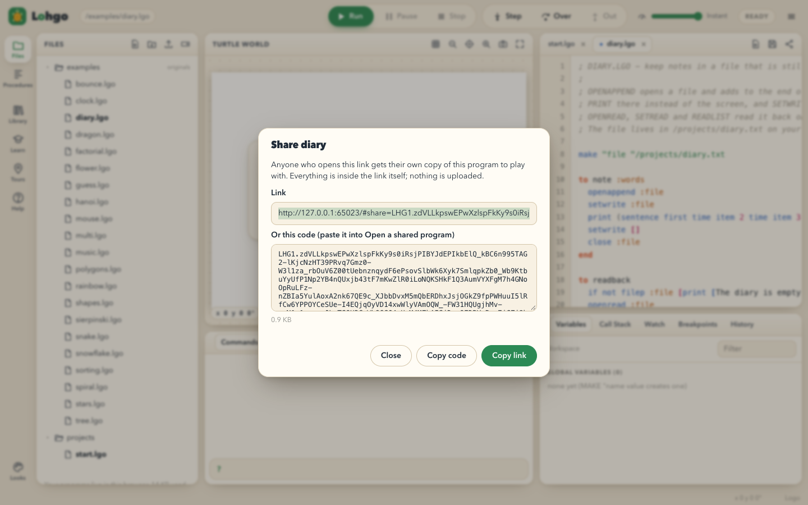

## Themes

Paper is the default. There are also Chalkboard, Blueprint and Midnight, and a green
screen theme for anyone who misses the phosphor.

<p>
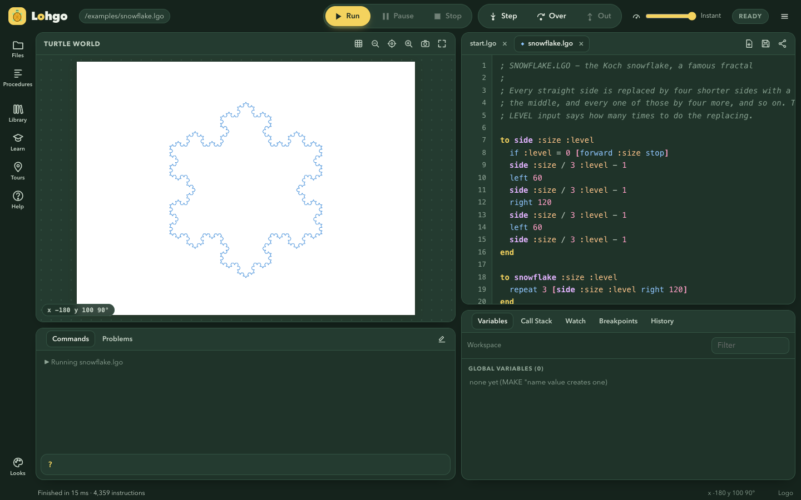
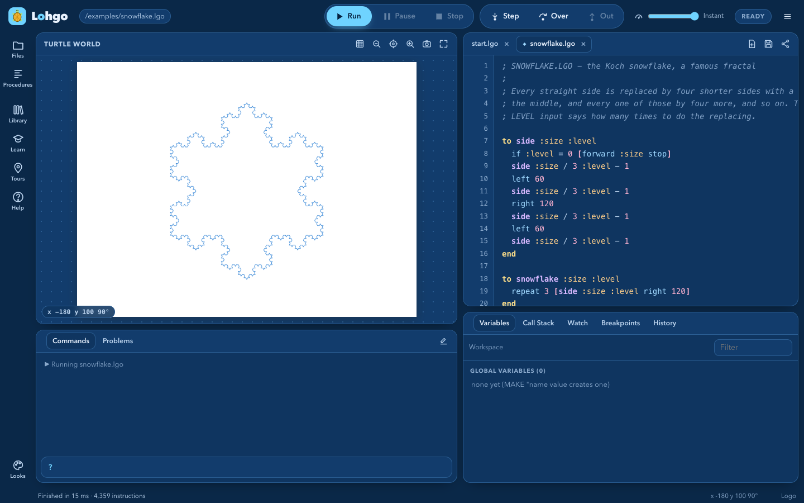
</p>
<p>
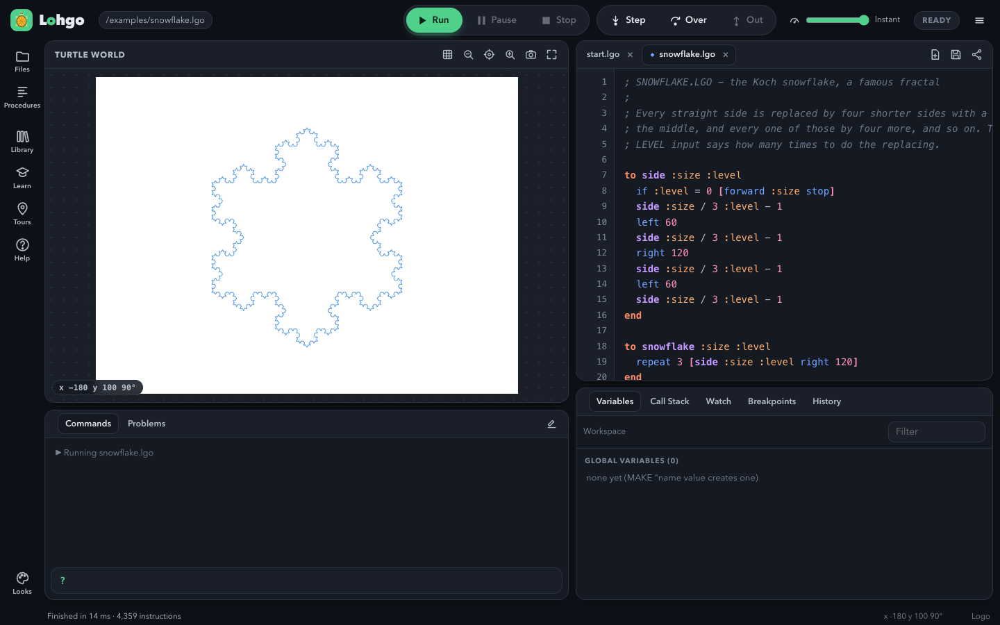
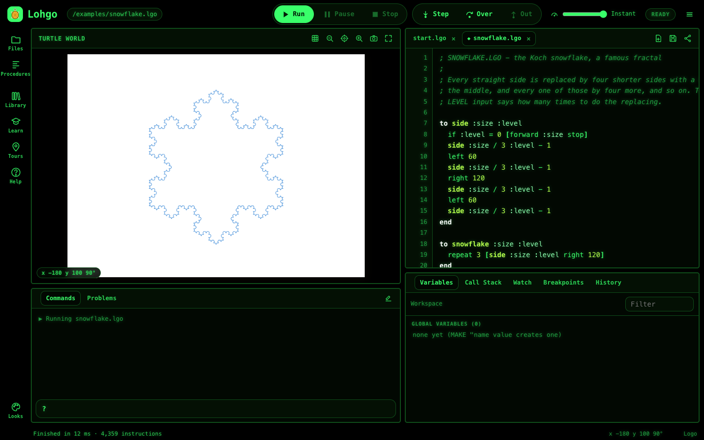
</p>

## Phones and tablets

On a phone, Lohgo shows one view at a time with a tab bar along the bottom: the turtle
world with the command center under it, the code, the debugger and the files. On touch
screens a small keypad with arrow keys, Space, Enter and Esc appears over the turtle world
so keyboard games work without a keyboard. Turn the phone sideways and the turtle world and
the command center sit side by side. On a tablet everything is on one screen and the files
slide in from the side.

<p>
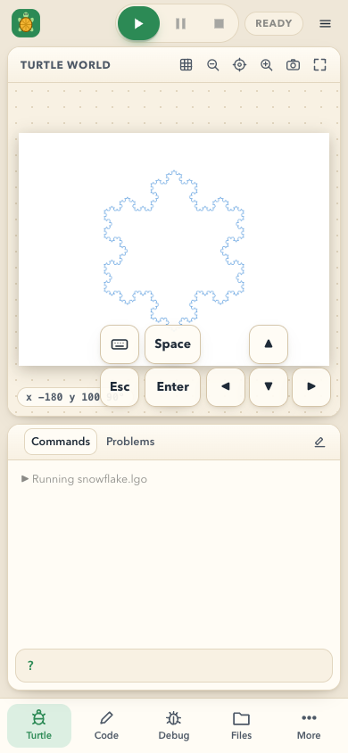
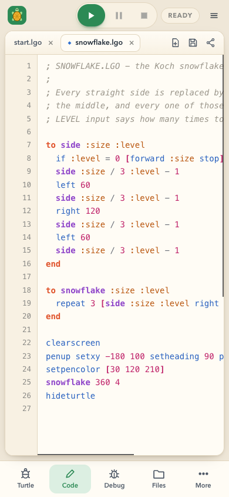
</p>

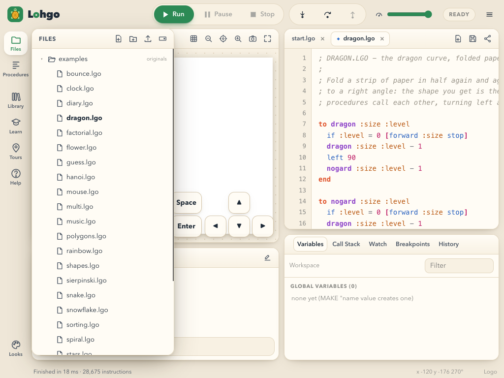

## Running it locally

There is nothing to install. Serve the folder with any static file server, for example

```
python3 -m http.server 8080 --bind 127.0.0.1
```

and open http://127.0.0.1:8080/. Opening `index.html` straight from the disk also works,
although a page opened that way cannot use a real folder from your computer.

To rebuild `index.html` from the sources you need Node 20 or newer, and no packages:

```
npm run build
```

## How it is built

The source is plain JavaScript with no framework and no dependencies. The build script
packs the examples, the lessons, the reference and the compressed library into the page
and inlines everything into one `index.html`, which is what GitHub Pages serves.

The interpreter reads Logo the way Berkeley Logo does. The reader turns text into words,
lists and arrays, keeping the line and column of every word so the debugger can find it
again. Before a line runs, it is split around infix operators and turned into expression
trees using the number of inputs each procedure takes, and those trees are cached until a
procedure is defined or erased.

Running is the interesting part. Every instruction runs inside a JavaScript generator, and
a call to a Logo procedure does not use the JavaScript stack: the generator hands the call
to a small driver loop, which pushes a frame onto a stack of its own. That is why
recursion is limited only by memory (a hundred thousand levels is fine), why the program
can pause between any two instructions, and why every frame stays available for the
debugger to inspect and change. `output`, `stop`, `throw` and errors unwind through the
generators. Simple expressions and common forms like `if`, `repeat` and `output` take a
fast path, and a recursive Fibonacci makes about half a million procedure calls a second
in Chrome. The driver hands control back to the page every few milliseconds, so a program
that never stops never freezes the page.

The turtle world draws on its own canvas at twice the world's size, on a transparent
layer, with the background colour and the turtles painted when it is shown. Changing the
background never touches the drawing, and erasing really erases.

## Testing

The project is tested without any manual clicking. `npm test` runs the language tests,
which run Logo programs and compare what they print with the expected output, the
debugger tests, and every example program. The library, the lessons and the reference
each have a checker: `node tools/check-lib.mjs library` runs every library program
headlessly with typed answers for programs that ask questions, `node tools/check-lessons.mjs`
runs every snippet in every lesson and checks every step, and
`node tools/check-help.mjs --examples` makes sure every primitive has a reference page and
every example runs.

The end to end tests under `tests/e2e` drive the real built page in headless Chrome
through the DevTools protocol, with real mouse, keyboard and touch input. There are about
4,700 of them, and they cover the
command center, the editor, running and stopping, every primitive group, the turtle world
and its controls, the debugger and every panel, files and sharing, the library, every step
of every tour and lesson, the reference, themes, and the phone and tablet layouts. Any
error on the page fails a test.

```
npm test
node tests/e2e/run.mjs
node tests/e2e/run.mjs --spec debugger
```

The screenshots in this README are taken by `node tools/shoot.mjs` from the built page.

## Project layout

```
src/core         small helpers, the virtual disk, sound
src/logo         reader, parser, interpreter, primitives, turtle world,
                 debugger support, syntax colouring, reference text
src/ide          the studio: turtle view, command center, editor, debugger
                 panels, files, library, lessons, tours, help, themes
samples          the example programs
library          the program library, one folder per category
assets           the photo on the About the author page
tests            language and debugger tests, and the headless end to end tests
tools            build helpers, checkers, the Chrome driver, screenshots
```

## Limitations

A browser cannot do everything a desktop Logo can. `shell` is not available, `epspict` is
replaced by `savepict`, which saves a PNG, and files live on the browser's disk rather than
the computer's, unless you choose a folder from your computer. Lohgo has no 3D turtle and
no MIDI. The text window is a scrolling transcript, so `setcursor` positions text on a page
that starts at the last `cleartext` rather than on a fixed-size screen. Programs that rely
on the exact speed of an old computer will run much faster here; `wait` is the way to slow
them down.

## Trademarks

"Logo" is the name of a programming language and is used here in that sense. MicroWorlds
and LogoWriter are trademarks of Logo Computer Systems Inc., Terrapin is a trademark of
Terrapin Software, Apple and Apple II are trademarks of Apple Inc., Windows is a trademark
of Microsoft Corporation, Chrome is a trademark of Google LLC and GitHub is a trademark of
GitHub, Inc. Berkeley Logo, MSWLogo and FMSLogo are the work of their authors. These names
are used only to describe compatibility and history. Lohgo is an independent
implementation, it contains no code from any of these projects or companies, and it is not
affiliated with or endorsed by any of them.

## License

Lohgo is free software under the GNU General Public License, version 3 or later. See
`LICENSE` for the full text and `COPYRIGHT` for the notice.

Under section 7 of the license there is one additional term, written out in full in
`NOTICE`. Any copy, modification or derived work, including a hosted version, must keep the
attribution "Based on Lohgo by Jyotiprakash Mishra (https://lohgo.jyotiprakash.org)" in its
source and show it in its about screen or other legal notices. This applies to the program,
the lessons, the reference and the programs in the library.

Copyright (C) 2026 Jyotiprakash Mishra
